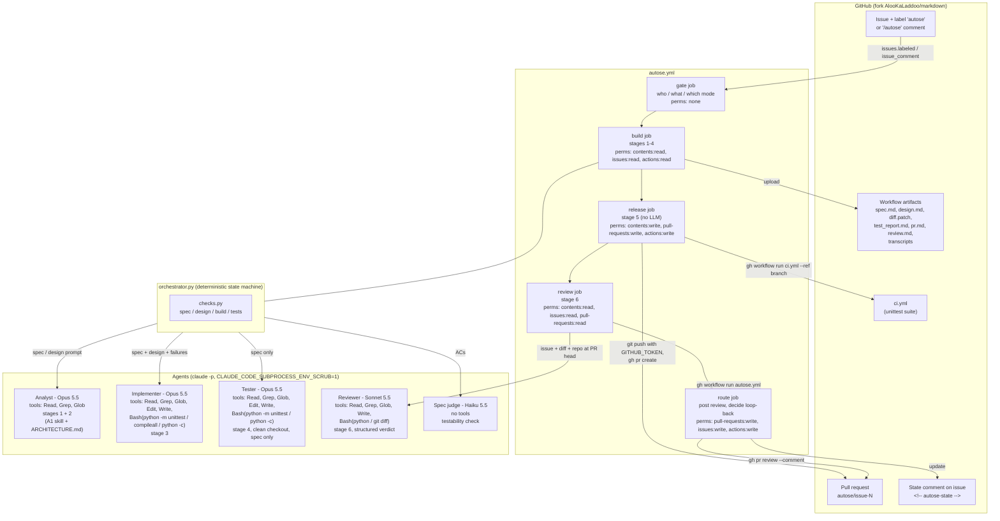

# Component view

The workflow runs in the fork `AlooKaLaddoo/markdown` (Python-Markdown pinned at `3f2c551`). One GitHub Actions workflow (`.github/workflows/autose.yml`) contains five jobs. Agents are headless Claude Code sessions (`claude -p`). Each session is started by a deterministic Python orchestrator (`.github/autose/orchestrator.py`) with its own system prompt, its own tool list and its own model. No agent ever holds a GitHub token. Only deterministic steps talk to GitHub.

## What each component may do

| Component | Model | Tools / permissions | Can push? | Sees |
|---|---|---|---|---|
| gate job | none | none (`permissions: {}`) | no | event payload |
| Analyst (stages 1, 2) | `claude-opus-5-5` | Read, Grep, Glob | no | issue (as untrusted data), repo, `ARCHITECTURE.md`, A1 skill; on loop-back: `review.md` or failing test summary |
| Spec judge | `claude-haiku-5-5` | none | no | acceptance criteria only |
| Implementer (stage 3) | `claude-opus-5-5` | Read, Grep, Glob, Edit, Write, `Bash(python -m unittest:*)`, `Bash(python -m compileall:*)`, `Bash(python -c:*)` | no | `spec.md`, `design.md`, repo; on retry: failing test output; on loop-back: `review.md` |
| Tester (stage 4) | `claude-opus-5-5` | Read, Grep, Glob, Edit, Write, `Bash(python -m unittest:*)`, `Bash(python -c:*)` | no | `spec.md` and a clean checkout of the base commit only |
| orchestrator + checks | none | runs tests, compiles, parses artifacts; runs agent-written code outside the sandbox, without credentials since PR #21 | no | everything (it is code) |
| release job | none | `contents: write`, `pull-requests: write`, `actions: write` | yes (only `autose/*` branches) | artifacts from build |
| Reviewer (stage 6) | `claude-sonnet-5-5` | Read, Grep, Glob, Write, `Bash(python:*)`, `Bash(git diff:*)` | no (no token, `persist-credentials: false`) | issue, diff, repo at PR head commit |
| route job | none | `pull-requests: write`, `issues: write`, `actions: write` | no | `verdict.json` |
| human maintainer | - | merge button | yes | everything |
