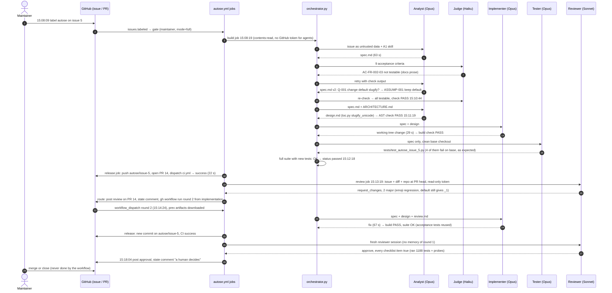

# Sequence view: one real run, issue #5 (the vague issue), two rounds

Runs [45421953103](https://github.com/AlooKaLaddoo/markdown/actions/runs/45421953103) (round 1) and [45423178755](https://github.com/AlooKaLaddoo/markdown/actions/runs/45423178755) (round 2, dispatched by round 1's route job); PR [#14](https://github.com/AlooKaLaddoo/markdown/pull/14). Times are UTC on 2026-11-24, taken from `state.json` and the job records.

Total wall-clock: 6 min 20 s (round 1) + 3 min 41 s (round 2).
