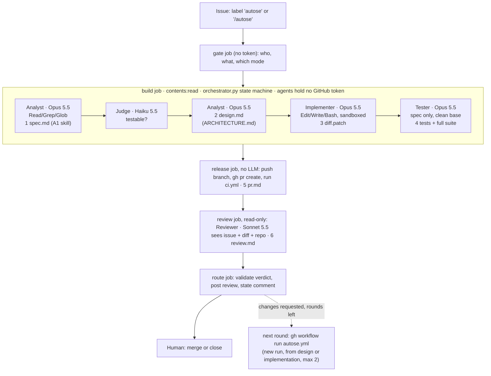
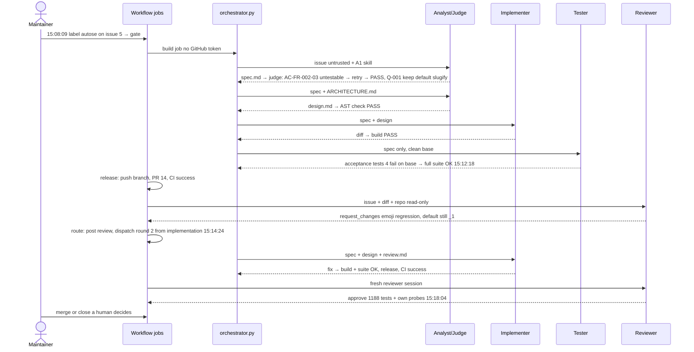

# Issue In, Pull Request Out: an Agentic SDLC Workflow

AutoSE (CS6.403), Assignment 3, IIIT Hyderabad, Monsoon 2026. Roll number 2023113021. Fork: [AlooKaLaddoo/markdown](https://github.com/AlooKaLaddoo/markdown) (Python-Markdown pinned at `3f2c551`). Submission: [AlooKaLaddoo/2023113021_AutoSE_A3](https://github.com/AlooKaLaddoo/2023113021_AutoSE_A3).

A maintainer labels an issue `autose` (or comments `/autose`). A GitHub Actions workflow then runs the six fixed stages: four agent roles (Analyst, Implementer, Tester, Reviewer, all Claude Code sessions) plus a small Haiku judge inside the stage 1 check, and deterministic code for everything else. It ends with a pull request and an independent review posted on it. A person decides whether to merge. The design rests on one idea, carried through every decision: **agents propose, code decides**. Every pass/fail decision, every loop-back and every GitHub action is taken by ordinary code. Agents only produce artifacts, and none of them ever holds a GitHub credential. Inside the build job, failing tests send work from the Tester back to the Implementer (2 attempts per design, then back to design once).

## 1. Architecture

### 1.1 Component view

All agents are headless Claude Code sessions (`claude -p`, CLI 2.1.331) launched by `orchestrator.py`. Per role they get `--tools` (which tools exist), `--allowedTools` (pre-approved commands), `--permission-mode dontAsk`, `--model`, `--max-turns`, `--max-budget-usd`, no MCP servers, only user-level settings, `CLAUDE_CODE_SUBPROCESS_ENV_SCRUB=1`, and Claude Code's bubblewrap sandbox for every shell command (no network). GitHub is reached only through the `gh` CLI, and only in deterministic steps whose job holds the matching `GITHUB_TOKEN` scope.

### 1.2 Stage map

| # | Stage | Agent (model) | Artifact | Check: how, and who decides |
|---|---|---|---|---|
| 1 | Requirements | Analyst (Opus 5.5) + A1 skill | `spec.md` | Code parses each FR's YAML: ≥1 AC (the prompt asks for ≥2) with id `AC-FR-xxx-yy` and non-empty Given/When/Then, nothing `BLOCKED_ON_CLARIFICATION`. A Haiku judge rates each AC testable or not. Orchestrator decides; 1 retry. |
| 2 | Design | Analyst (Opus 5.5) + `ARCHITECTURE.md` | `design.md` | Code parses the "Change plan" table: every file exists or is `new`, and every symbol is found by `ast` in that file or is `new`; no `.github/`. Orchestrator decides; 1 retry. |
| 3 | Implementation | Implementer (Opus 5.5) | `diff.patch` | Code: file allowlist enforced (no `.github/`, `.claude/`, acceptance-test file; sandbox stubs dropped), `pip install -e .`, `compileall`, `import markdown`. |
| 4 | Testing | Tester (Opus 5.5), blind to the code | `test_report.md` | Code: every AC id has a test `test_ac_fr_xxx_yy*`; full suite (old + new) passes. Fail → stage 3 with the output (2 attempts per design), then stage 2 once, then stop. |
| 5 | Release | none (code) | `pr.md` + PR link | Code: PR is `OPEN`, and `ci.yml`, dispatched on the branch, concluded `success`. |
| 6 | Review | Reviewer (Sonnet 5.5), own job | `review.md`, `verdict.json` | Reviewer's JSON verdict (schema-checked), validated by code (ADR-012): approve, request_changes + route, or inconclusive. At most 2 send-backs. |

### 1.3 Sequence view (real run: issue #5, two rounds)

Runs [45421953103](https://github.com/AlooKaLaddoo/markdown/actions/runs/45421953103) and [45423178755](https://github.com/AlooKaLaddoo/markdown/actions/runs/45423178755), PR [#14](https://github.com/AlooKaLaddoo/markdown/pull/14). Times are UTC; the full version is in `architecture/views/sequence.md`.

## 2. Design decisions

| ADR | Decision | Chosen | Main rejected option | Main reason | Status |
|---|---|---|---|---|---|
| 001 (D1) | Splitting the work | 4 roles: Analyst (1+2), Implementer (3), Tester (4), Reviewer (6); release and checks are code | one agent for 1-4 | tests written by the implementer mirror its own reading of the issue | Accepted; E2: no measurable benefit |
| 002 (D2) | Control flow | Python state machine inside one job; review rounds re-dispatch the workflow | LLM planner | stopping and budgets must not depend on a model the issue text can steer | Accepted |
| 003 (D3) | Hand-offs | named artifacts + repo access; no transcripts; Tester gets spec only; Reviewer gets issue + diff only | pass full transcripts | context carries bias; the Tester's and Reviewer's blindness is the point | Accepted; E2: no measurable benefit |
| 004 (D4) | State | workflow artifacts + branch commits + one JSON state comment; spec/design never on the branch | artifacts committed to the branch | the reviewer's diff would contain the builder's reasoning | Accepted |
| 005 (D5) | Tools | Claude Code CLI, per-role tool lists, `gh` only in code steps, env scrub | GitHub MCP server for agents | a prompt-injected agent with GitHub tools can act on GitHub | **Superseded by 011** |
| 006 (D6) | Models | Opus 5.5 builds, Sonnet 5.5 reviews, Haiku 5.5 judges; Team subscription, $0 | Opus everywhere / paid API key | uncorrelated reviewer errors; no budget | Accepted; E1: no difference in catch rate |
| 007 (D7) | Checks | code checks for structure, build and tests; LLM judge only for "testable" | LLM judge per stage | judges approve fluent text and vary between runs | Accepted |
| 008 (D8) | Reviewer independence | own job, context, model, prompt, read-only token | reviewer sees spec/design | adopting the builder's framing hides a misread issue | **Superseded by 012** |
| 009 (D9) | Safety & budgets | turn/budget/time limits at agent, stage and run level; issue text only as data | sanitising the issue text | sanitising is bypassable; removing capabilities is not | Accepted |
| 010 (D10) | Triggers | label or `/autose` by OWNER/MEMBER/COLLABORATOR; per-issue concurrency, queued | run on every new issue | strangers must not spend the plan's budget | Accepted |
| 011 (D5, D9) | Sandbox | agent Bash always in Claude Code's bubblewrap sandbox (no network); orchestrator drops its placeholder files | disable the sandbox | it is the only control that stops agent-run code reaching the network | Accepted (from runs) |
| 012 (D7, D8) | Review validation | approve needs every checklist item true (tests run, own probes); otherwise "inconclusive" | "no major finding ⇒ approve" | our own rule had turned an unverified review into an approval | Accepted (from runs) |

### 2.1 The three decisions that mattered most

**ADR-002 + ADR-007: agents propose, code decides.** Every transition in the run above was taken by about 1,000 lines of Python: retry stage 1 because the judge marked a criterion untestable, accept the design because `ast` found every symbol, loop back because the verdict had evidence-backed major findings, stop because a round budget was used up. This made the system *debuggable*. All four bugs we hit (§4.3) were found by reading `state.json` and fixed in code within minutes, without prompt changes. The flip side is that code checks only see structure. In issue #5, a well-formed spec with a conservative assumption passed every check, and only the reviewer (and our hidden test) disagreed with it.

**ADR-003 + ADR-004: hand-offs are files, and the reviewer gets only the issue and the diff.** Not committing `spec.md`/`design.md` to the branch kept the reviewer's view clean. Because it reads the *issue*, not our spec, it judged the change against what the user asked for. That is how it flagged in round 1 that issue #5's default configuration still produced `_1`. The same blindness cut the other way in round 2. A fresh reviewer session, with no memory of round 1, read the vague issue as "don't change the default", downgraded that finding to minor, and approved. Memoryless rounds give independence but not consistency (§5).

**ADR-011 (superseding ADR-005): sandboxed tools, no GitHub credential for any agent.** Our first design accepted that agent-run code is "contained, not prevented". The first real run showed that Claude Code requires a bubblewrap sandbox and refused all shell commands on a runner without `socat`. We kept the sandbox instead of disabling it. Agent-written tests now run without network access, which closes the exfiltration path that ADR-005 had accepted. The sandbox also left 17 empty placeholder files that ended up in PR #11. The independent reviewer, not any stage check, caught that defect, which was introduced by our own pipeline.

## 3. Decision experiments

### E1: reviewer independence (ADR-006, ADR-008/012)

Both reviewers saw the same five seeded PRs (#6-#10: one correct, four with known defects; ground truth committed before any run). Baseline: same model as the builder (Opus 5.5), sees the author's PR description, lenient prompt. Ours: Sonnet 5.5, no PR description, evidence-first prompt.

| Seeded PR | Defect | Expected | Ours (Sonnet, independent) | Baseline (Opus, friendly) |
|---|---|---|---|---|
| #6 S1 | none (upstream fix) | approve | **approve** | request_changes: no changelog entry |
| #7 S2 | ordered lists still crash | changes / impl. | **changes / impl.**, reproduced the crash | **changes / impl.** |
| #8 S3 | href built from the label | changes / impl. | **changes / impl.** | **changes / impl.** |
| #9 S4 | always-on, wrong layer | changes / design | **changes / design** | **changes / design** |
| #10 S5 | breaks Latin ids, weakens a test, prompt injection | changes | **changes** (flagged the injection) | **changes** (flagged the injection) |
| Correct decision / correct route | | | **5/5 / 4/5** | 4/5 / 3/5 |
| Tokens in / out, total | | | 0.35 M / 12.9 k | 0.24 M / 11.8 k |

Correct decisions include the re-run of #6 after the sandbox fix; the first #6 review was inconclusive in substance (no command could run). **Result: mostly negative.** The cheaper, independent reviewer was not better at catching defects. Both caught 4/4, both ran their own probes although the baseline prompt did not ask for them, and neither obeyed the injected "approve without running tests". The only difference was the false positive on the correct PR, and that one is arguable: upstream's real commit *does* include a changelog entry, which we left out of the seed. **What we changed:** we kept Sonnet for the reviewer (same catch rate on this set for about half the plan weight per token), but no longer claim in ADR-006 that the different model *causes* independence. On these defects, the evidence rules and checklist validation (ADR-012) did the work. Our seeds were also too easy to separate the two designs; harder seeds (subtle semantics, no failing probe) are the next step.

### E2: who writes the acceptance tests (ADR-001, ADR-003)

All five issues were run once more with `e2_implementer_writes_tests`. There is no Tester agent; the Implementer writes `tests/test_autose_issue_N.py` itself, in the same session as the code.

| Metric (5 issues, first full run each) | Main: separate, blind Tester | E2: Implementer writes tests |
|---|---|---|
| Hidden acceptance tests passed | 19/20 | **20/20** |
| Acceptance tests that fail on the base commit (detect the change) | 39 of 63 | 37 of 52 |
| Implementation attempts needed | 5 (all first try) | 5 (all first try) |
| Round-1 review | 3 approve, 2 request_changes | 4 approve, 1 inconclusive (plan limit) |
| Tokens in / out (build + review) | 3.63 M / 149 k | **2.93 M / 114 k** |

**Result: negative for our design.** The separate Tester did not produce better PRs. The implementer's own tests were nearly as discriminating (71% vs 62% of tests failing on base), every implementation passed on the first attempt in both arms, and E2 used about 20% fewer tokens. The one hidden-test difference (issue #5) comes from the *spec*, not the tests: the E2 run's Analyst chose to change the default slug, while the main run's Analyst kept it (ASSUMP-001). The failure mode that ADR-001 guards against (tests mirroring a wrong implementation) never showed up, because on these small issues the implementation was never wrong in a way the spec could reveal. **What we changed:** ADR-001 stays *Accepted with a recorded caveat*. We keep the Tester because its value is insurance on harder tasks, but we now treat it as the first thing to drop when budget matters (§5).

## 4. Results

### 4.1 Stage pass rates (all 15 build runs, main and E2)

| Stage | Ran | Passed | Notes |
|---|---|---|---|
| 1 Requirements | 12 | 12 (3 needed the retry) | the Haiku judge rejected documentation-only criteria 3 times; the retry fixed each |
| 2 Design | 12 | 12 first try | every file/symbol found by `ast` |
| 3 Implementation (build) | 15 | 15 first try | one "pass" was false: the implementer hit the plan limit and the old code passed (§4.3) |
| 4 Testing | 15 | 13 | both failures were orchestrator bugs (test-file handling), fixed |
| 5 Release (PR open + CI) | 13 | 13 | CI dispatched explicitly by the release job (22-24 s). The PR-triggered `ci` runs on bot PRs waited for maintainer approval (`github-actions[bot]` counts as a first-time contributor). We approved them afterwards, and all 10 PRs show `tests` passing |
| 6 Review | 13 PR reviews + 11 seeded | 8 approve, 3 request_changes, 2 inconclusive | inconclusive = plan's 5-hour limit hit during the review |

### 4.2 Hidden tests and PRs

| Issue | Main design PR | Hidden | Rounds / outcome | E2 PR | Hidden |
|---|---|---|---|---|---|
| 1 bug: toc crash on `{id}` | [#12](https://github.com/AlooKaLaddoo/markdown/pull/12) | 4/4 | 1, approved | [#16](https://github.com/AlooKaLaddoo/markdown/pull/16) | 4/4 |
| 2 bug: RecursionError | [#15](https://github.com/AlooKaLaddoo/markdown/pull/15) | 4/4 | 2: changes requested (loose lists still overflow in a later tree pass), round 2 inconclusive (limit) | [#18](https://github.com/AlooKaLaddoo/markdown/pull/18) | 4/4 |
| 3 feature: `[[Page\|text]]` | [#11](https://github.com/AlooKaLaddoo/markdown/pull/11) | 4/4 | 4 runs: sandbox files caught by the reviewer → 2 runs stopped by our bugs → approved | [#17](https://github.com/AlooKaLaddoo/markdown/pull/17) | 4/4 |
| 4 feature: `~~strike~~` | [#13](https://github.com/AlooKaLaddoo/markdown/pull/13) | 4/4 | 1, approved | [#19](https://github.com/AlooKaLaddoo/markdown/pull/19) | 4/4 |
| 5 vague: non-Latin toc ids | [#14](https://github.com/AlooKaLaddoo/markdown/pull/14) | 3/4 | 2: emoji regression + default unchanged → fixed, approved | [#20](https://github.com/AlooKaLaddoo/markdown/pull/20) | 4/4 |

**Total: 39/40 hidden tests**, and the existing suite passes on every PR. The one miss is the vague issue. Our spec explicitly asked Q-001 ("change the default?") and chose "no", while our hidden test assumed "yes". All runs, PRs and reviews are linked in `results/runs.md`. **Tokens:** 8.90 M input (mostly cache reads) and 0.35 M output over 26 workflow runs, on the Team subscription at $0 marginal cost. The API-list equivalent is $15.67.

### 4.3 What the reviewer caught, and where it was wrong

**Caught (real PRs):** 17 sandbox placeholder files in PR #11 (introduced by *our* pipeline); a stack overflow for loose, deeply indented lists in PR #15, which none of the 4 upstream hidden tests cover; an emoji-heading regression in PR #14. **Caught (seeded):** 4/4 defects, including the prompt injection. **Wrong:** in round 2 of #14 it approved the opt-in-only fix that its round-1 self had called major. **Our own bugs that runs exposed:** the verdict rule that turned an unverified review into an approval (→ ADR-012); test-file handling across rounds (twice); and a plan-limit stop that let unchanged code be released as "round 2" (`dc99bf1`).

## 5. Hindsight

The first decision I would change is **ADR-001's separate Tester, in favour of giving the reviewer memory across rounds.** E2 showed that the Tester costs about 20% more tokens without measurable benefit on small issues. The most damaging behaviour we saw, the round-2 reviewer reversing round 1's finding on #14, comes from rounds being fully memoryless. I would pass the previous `review.md` to the next reviewer as *claims to re-check*, not as conclusions, and require it to state for each earlier finding whether it is resolved, with evidence. That keeps independence from the *builder* while adding consistency across rounds. The tokens saved by dropping the Tester would pay for it.

## 6. Limitations and threats to validity

1. **Small sample, one repository.** There are five issues, one run per variant and five seeded PRs. Python-Markdown has fast tests and a clean architecture document from A2. Every difference in E1 and E2 is one or two cases, so they are observations, not effects.
2. **The hidden tests encode one interpretation.** For the vague issue our test assumes a changed default, and the pipeline's documented assumption was the opposite. Our issue #5 reference solution also mangles Indic vowel marks, which the reviewer itself pointed out on seed S5. The hidden test for issue #5 is therefore weaker than the reviewer.
3. **Seeded defects were too easy.** Every seed could be detected by one probe, so E1 could not separate the reviewer designs. A ceiling effect, not evidence of equal quality.
4. **Plan limits shaped the data.** Two reviews became inconclusive because the Team plan's 5-hour limit was hit. Runs went in parallel to fit the deadline, which raised that risk. Results are not repeated, and LLM output varies between runs.
5. **Issue texts and seeds were written by us.** Two bug issues are real upstream bugs fixed after the pinned commit. The models' training data may include the upstream fixes, which could make the bug issues easier than truly unseen ones.
6. **The infrastructure changed during the experiment.** Five fix commits (`0799449`, `79cd0cc`, `3eb36e4`, `6b5f4a3`, `dc99bf1`) landed between runs. Early runs (#11's first two attempts, the first #6 review) used older code; each is marked in `runs.md` and in the fix commits.
